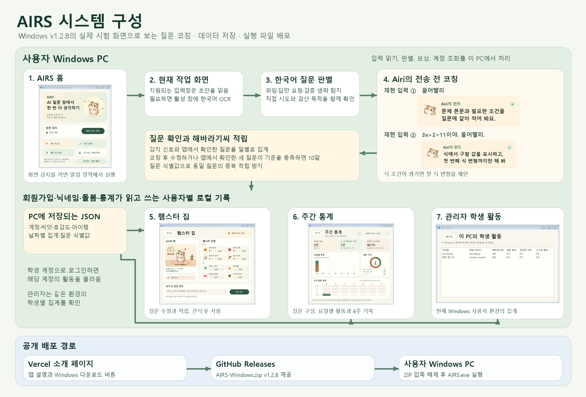

# AIRS

AIRS(AI Reliance Regulation System)는 생성형 AI에 질문을 작성할 때 햄스터 Airi가 직접 해 볼 다음 행동을 제안하는 Windows 데스크톱 앱입니다. 팀 MINT가 교육활동 개선을 주제로 만들었습니다.

[Windows v1.2.8 ZIP 받기](https://github.com/jeong1-j/AIRS/releases/download/v1.2.8/AIRS-Windows.zip) · [릴리스](https://github.com/jeong1-j/AIRS/releases/tag/v1.2.8) · [자료 출처와 이용 조건](THIRD_PARTY_NOTICES.md)

[앱 소개 페이지](https://airs-mint.vercel.app/) · [시연 영상 · 2분 27초](https://github.com/jeong1-j/AIRS/releases/download/v1.2.8/AIRS-Demo-v1.2.8.mp4) · [발표 이미지와 설명](https://github.com/jeong1-j/AIRS/releases/download/v1.2.8/AIRS-Screen-Captures-v1.2.8.zip)

## Windows에서 실행

1. 실행 중인 이전 AIRS가 있으면 작업 표시줄 오른쪽 알림 영역에서 AIRS 아이콘을 우클릭하고 **종료**를 선택합니다.
2. ZIP을 **모두 압축 풀기** 한 뒤 `AIRS.exe`를 실행합니다.
3. **화면 감지 시작**을 누르고 ChatGPT Windows 앱의 입력칸을 선택합니다. 입력창을 직접 읽을 수 있으면 알림 영역 아이콘에 **채팅 입력칸 연결됨**이 표시됩니다.
4. `풀어빨리`를 쓴 뒤 전송 전에 잠깐 기다립니다. Airi가 나타나면 `3x+2=11이야. 풀어빨리.`처럼 조건을 추가해 안내가 바뀌는지 봅니다.
5. `내가 3x=9까지 정리했어. 다음 단계 힌트만 알려 줘.`처럼 질문을 고칩니다. 적립을 시험하려면 같은 창에서 안내 직후 수정하거나, **햄스터 집 → 내가 쓴 질문 확인**에서 새 질문을 확인합니다. 기준을 충족한 새 질문에는 씨앗 10알을 지급합니다.
6. **햄스터 집**에서 모은 씨앗을 사용하고 **주간 통계**를 확인합니다. 알림 영역에서 앱을 다시 열거나 감지를 중지하고 종료할 수 있습니다.

화면에서 글자를 읽는 기능은 Windows에 설치된 한국어 OCR을 사용합니다. 화면 감지가 어려우면 감지가 켜져 있는지, 현재 입력칸에 커서가 있는지, Windows의 한국어 인식 기능이 준비되어 있는지 확인하세요.

## 학생 계정과 데이터

**로그인 / 회원가입**에서 학생 계정을 만들고 닉네임을 설정하거나 변경할 수 있습니다. v1.2.8은 기존 관리자 계정이 없는 환경에 시연용 로컬 관리자 계정을 준비합니다. 관리자 화면은 같은 Windows 사용자 환경에 등록된 학생의 집계만 표시합니다.

AIRS는 입력과 화면 이미지를 PC에서 처리하고, 씨앗·보유 아이템·날짜별 활동과 중복 확인용 질문 식별값을 PC에 저장합니다. 기존 AI 서비스에 질문을 보내는 동작은 사용자가 해당 서비스에서 직접 합니다.

## 소스에서 빌드

Windows PowerShell에서 저장소 폴더로 이동한 뒤 실행합니다.

```powershell
powershell.exe -NoProfile -File .\source\build.ps1 -DesktopOnly
```

스크립트는 Windows의 .NET Framework 컴파일러와 Windows Runtime 메타데이터를 사용해 저장소 루트에 `AIRS.exe`를 생성합니다. `source/`에는 앱 코드, `dist/assets/`에는 빌드가 읽는 이미지와 아이콘이 들어 있습니다. `site/`는 앱 설명과 실행 파일 다운로드 버튼을 제공하는 정적 소개 페이지입니다.

## 시스템 구성



[발표용 앱 화면 10종과 설명](docs/screen-guide.png)

## 배포와 검증

최종 Windows 실행 파일은 v1.2.8 릴리스에 있습니다. [v1.2.8에 해당하는 앱 소스](https://github.com/jeong1-j/AIRS/tree/v1.2.8/source) · [기능 판별과 시연 안내](docs/DEMO.md)
